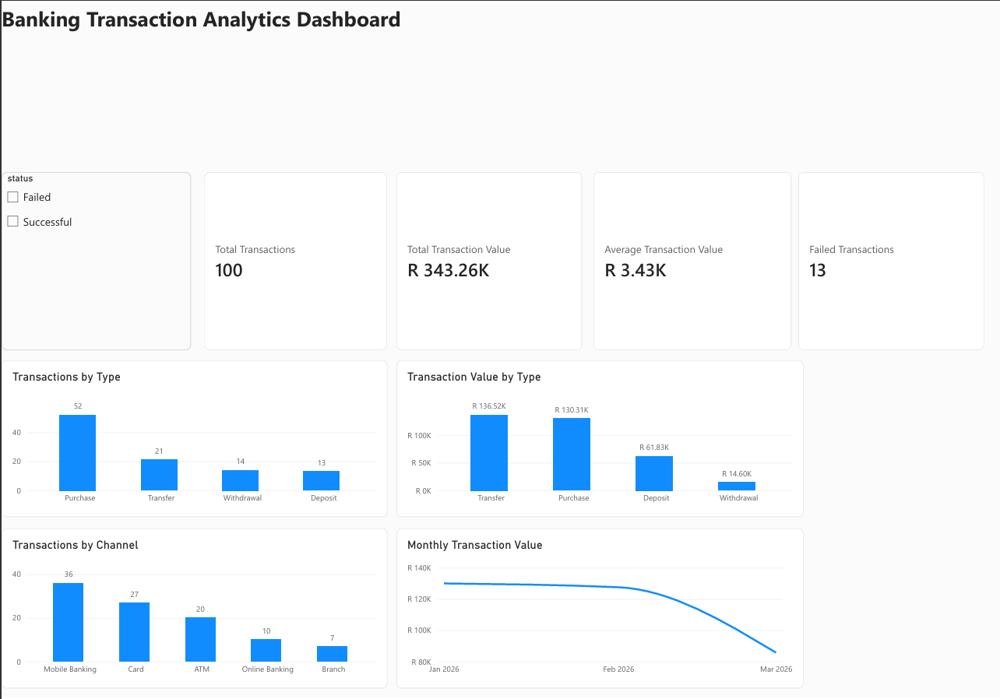

# Banking Transaction Analytics
A data analytics project using fictional banking transaction data to explore transaction patterns using SQL, Python/Pandas, data visualisation, and Power BI.

Note: All customer and transaction data used in this project is fictional and does not represent real customers or banking transactions.

## Tools Used
- SQL / SQLite
- Python
- Pandas
- Matplotlib
- Power BI
- Git & GitHub

## Analysis Performed
- Explored and filtered banking transaction data using SQL
- Used GROUP BY, HAVING, CASE, INNER JOIN, LEFT JOIN, and COALESCE
- Performed data-quality checks using Pandas
- Analysed transaction types, transaction values, banking channels, failed transactions, and monthly trends
- Created visualisations using Matplotlib
- Built an interactive Power BI dashboard with a transaction-status slicer

## POWER BI DASHBOARD 

## Key Findings
- Purchases were the most frequent transaction type, with 52 transactions
- Transfers recorded the highest total transaction value at R136,523.67
- Mobile Banking was the most frequently used channel, with 36 transactions
- 13 of 100 transactions were unsuccessful
- February had the highest transaction volume, with 36 transactions
- January recorded the highest monthly transaction value at R129,946.51
- Monthly transaction value decreased to R85,794.58 in March
- Transaction frequency and monetary value produced different rankings, showing why both measures are useful when analysing transactional activity
## Project Structure
- data/ - Fictional banking transaction dataset
- sql/ - SQL table setup and analysis queries
- python/ - Pandas analysis
- charts/ - Python-generated visualisations
- dashboard/ - Power BI dashboard image and PDF

## What I Learned

This project strengthened my practical understanding of analysing the same dataset across SQL, Python, and Power BI, validating results between tools, and translating data analysis into clear visual insights